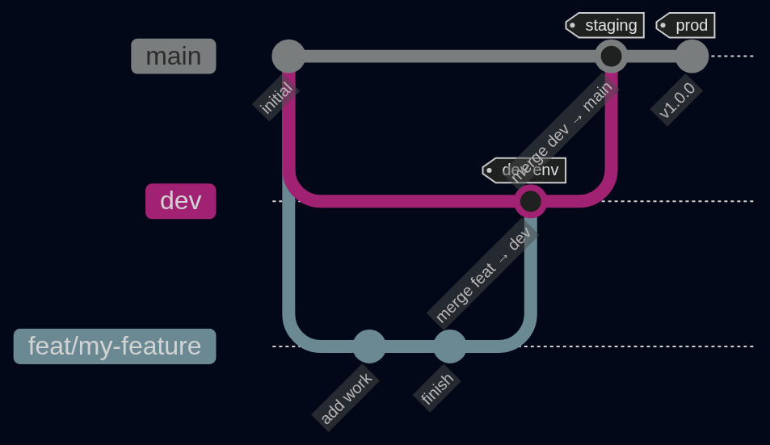

# Contributing to BroadcastMail

## Contents

- [Prerequisites](#prerequisites)
- [Getting started](#getting-started)
- [Git flow](#git-flow)
- [Branches](#branches)
- [Commits](#commits)
- [Pull requests](#pull-requests)
- [Code style](#code-style)
- [Tests](#tests)
- [Reporting issues](#reporting-issues)
- [License](#license)

## Prerequisites

- Java 25
- Node.js 22
- Docker (for local PostgreSQL)
- Maven 3.9+

## Getting started

```bash
git clone https://github.com/broadcastmail/<repo>.git
cd <repo>
./mvnw clean verify
```

See [DEVELOPERS.md](DEVELOPERS.md) in each repo for full local setup.

## Git flow



- `main` — production, tagged releases only (`v1.0.0`)
- `dev` — integration branch, all PRs target here, deploys to dev environment
- `feat/`, `fix/`, etc. — short-lived, branch from `dev`, merge back to `dev`
- `main` updated from `dev` on release via PR

## Branches

Branch from `dev`, target `dev` in your PR.

| Prefix | Use |
|---|---|
| `feat/` | New feature |
| `fix/` | Bug fix |
| `chore/` | Maintenance, dependencies |
| `docs/` | Documentation only |
| `refactor/` | Refactor without behaviour change |

## Commits

Follow [Conventional Commits](https://www.conventionalcommits.org):
```
feat: add audience preview endpoint
fix: handle null stripeCustomerId on plan enforcement
chore: bump springdoc to 2.8.9
```

One line, imperative mood, lowercase. No period at the end.

## Pull requests

- One PR per feature or fix
- PR title follows commit convention
- Link the issue: `Closes #N`
- Must pass CI before merge
- Squash merge to `dev`

## Code style

- Java — SonarLint clean, follow existing patterns
- TypeScript — ESLint clean
- No unused imports, no commented-out code
- Tests for all business logic

## Tests

- Unit tests — `./mvnw test`
- Integration tests require local Supabase, tagged `@Tag("local")`, excluded from CI
- New features must include tests

## Reporting issues

Use [GitHub Issues](https://github.com/broadcastmail/.github/issues). Bug reports and feature requests have separate templates.

## License

By contributing, you agree that your code will be licensed under the project's license.
