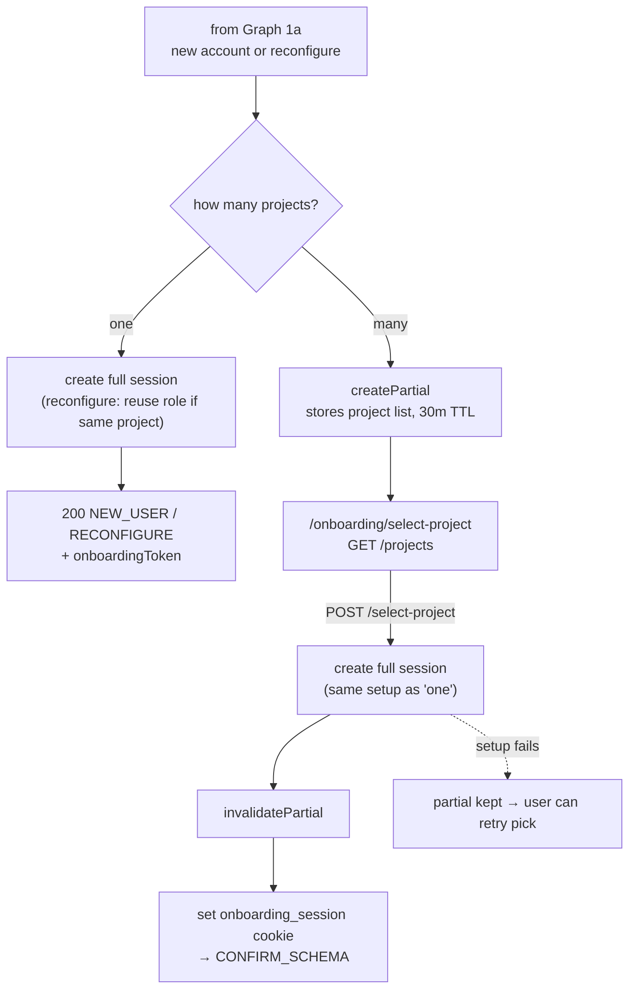

## Onboarding

## Graph 1a - C4 Level 3 State validation and user lookup
Question validated: does the callback check state and redirect origin before it exchanges the code or touches any user data, and does a project that's already connected always skip onboarding?
 ```mermaid
flowchart TD
    A["POST /oauth/supabase/callback"] --> B{"state matches +<br/>redirect origin allowed?"}
    B -- no --> E1["401 / 400 — nothing touched"]
    B -- yes --> X["PKCE token exchange<br/>+ listProjects"]
    X --> M{"any projects?"}
    M -- no --> E2["422 NoSupabaseProjects"]
    M -- yes --> N{"reconfigure intent<br/>with valid bm_session?"}
    N -- yes --> R["→ Graph 1b (reconfigure)"]
    N -- no --> P{"any project already<br/>has a Connection?"}
    P -- yes --> Q["rotateApiKey → RETURNING_USER<br/>→ /dashboard"]
    P -- no --> NU["→ Graph 1b (new account)"]
```

## Graph 1b - C4 Level 3 Project count determines onboarding path
Question validated: is the partial session invalidated only after the full session is created, so a failed project selection can be retried without redoing OAuth?



## Graph 2 — Backend enforces step preconditions, not the frontend
Question validated: if a user hits a step endpoint out of order, is the backend the last line of defense — not the frontend route guard?


## Graph 3 — C4 Level 2 What POST /onboarding/complete does
Question validated: are all three preconditions checked before any external writes, so a half-completed account is impossible?


## Graph 4 - C4 Level 2 User navigates away and comes back
Question validated: when a user returns mid-onboarding, does the backend determine where they resume — not the frontend?

